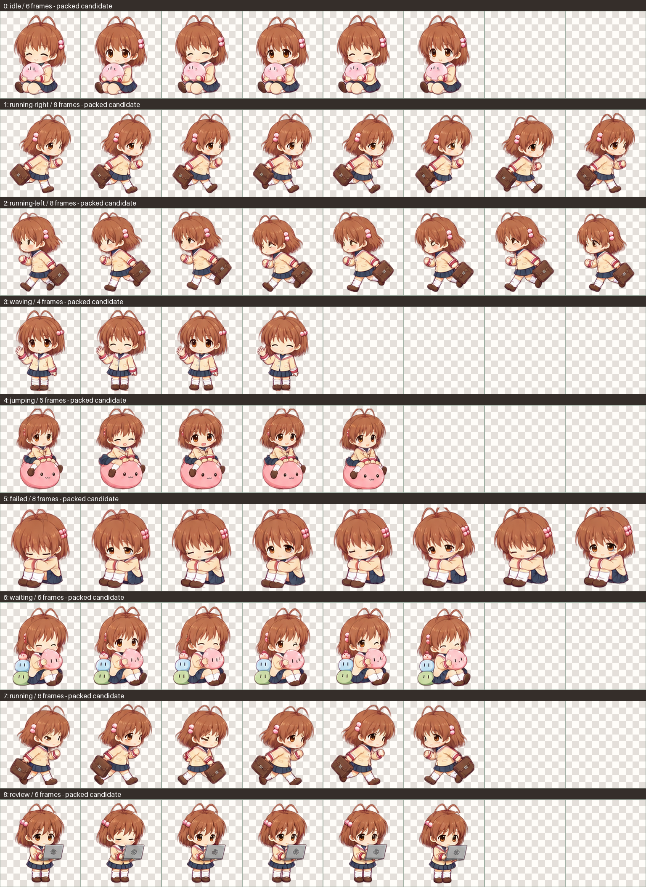

# 古河渚 Codex 宠物

这个仓库提供一套可直接安装的 Codex Desktop 自定义宠物资源，角色为《CLANNAD》里的古河渚。

## 统一画风候选版

新增 `nagisa-furukawa-soft/`，融合柔和 Q 版、古河渚角色特征与圆润团子感，统一全部 9 组动作的五官、栗棕发色、校服和暖棕描边。原版 `nagisa-furukawa/` 保留。



新版仍需在 Codex Desktop 实际尺寸下审阅动作观感，尤其跑步循环、跳跃和状态切换。静态生成图经过透明边缘清理、分格和尺寸规范化；这不能代替对动画流畅度的人工确认。

安装时将 `nagisa-furukawa-soft` 整个目录复制到 `~/.codex/pets/`（Windows 对应 `%USERPROFILE%\.codex\pets\`），选择 `custom:nagisa-furukawa-soft`。

用浏览器打开 [新旧动画对照页](previews/animation-preview.html)，可以切换动作、播放或逐帧检查，并调整背景、速度和缩放。也可以在仓库根目录执行 `python3 -m http.server 8765 --bind 127.0.0.1` 后打开 `http://127.0.0.1:8765/previews/animation-preview.html`。

制作说明见 [画风规范](artwork/STYLE.md)。原始生成候选为 `artwork/spritesheet-v2.png`，提示词保存在 `artwork/prompt.txt`；图像由内置 ImageGen 生成。获用户明确同意后，使用 Python/Pillow 进行图集后处理，脚本为 `scripts/build_atlas.py`，技术检查结果为 `artwork/validation.json`。

复现打包需要 Python 3.9+ 和 Pillow 10.1+（`python3 -m pip install 'Pillow>=10.1'`）：

```sh
python3 scripts/build_atlas.py
cp artwork/spritesheet-v2-packed.webp nagisa-furukawa-soft/spritesheet.webp
cp artwork/contact-sheet-v2.png nagisa-furukawa-soft/contact-sheet.png
```


## 仓库内容

`nagisa-furukawa/` 目录中包含：

- `pet.json`：宠物清单文件
- `spritesheet.webp`：宠物动画图集
- `contact-sheet.png`：动作预览图

## 安装方法

把整个 `nagisa-furukawa` 文件夹复制到你本机的 Codex 宠物目录里。

Windows 常见位置：

```text
C:\Users\你的用户名\.codex\pets\
```

复制完成后，目录结构应当是：

```text
C:\Users\你的用户名\.codex\pets\
  nagisa-furukawa\
    pet.json
    spritesheet.webp
```

然后在 Codex Desktop 里选择这只宠物。

- 自定义宠物目录名是 `nagisa-furukawa`
- 选择值应为 `custom:nagisa-furukawa`

如果你看到的是别的自定义宠物，通常说明目录名不对，或者没有选中 `custom:nagisa-furukawa`。

## 说明

这个仓库保存的是已经整理好的可安装版本，适合直接下载、复制和使用。
