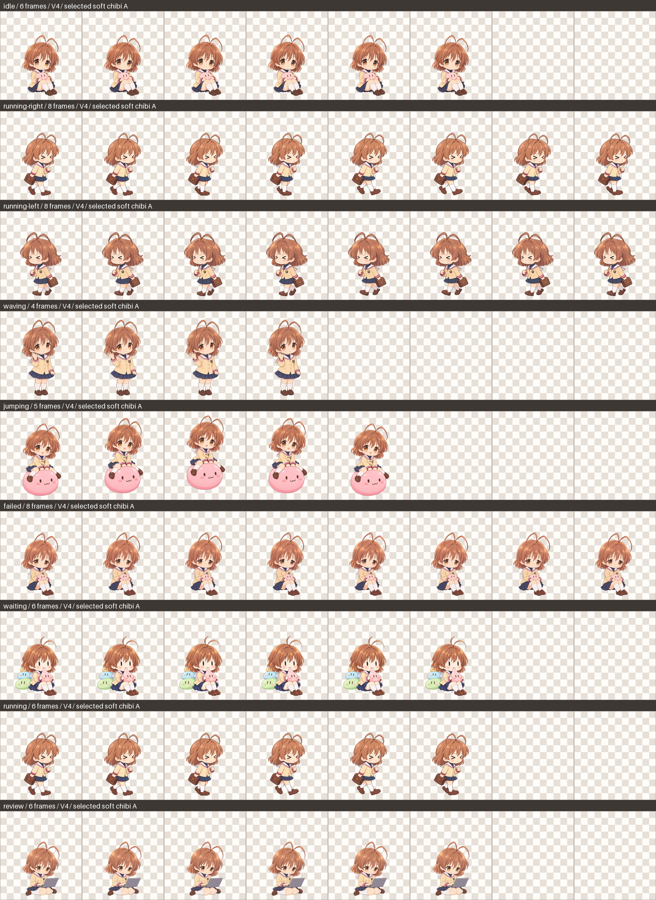

# 古河渚 Codex 桌宠

V4 采用用户选中的 **A「精致但柔软的 Q 版」**，统一 9 组动作的圆润脸型、暖栗棕高光、柔软染色与校服细节。原版与 V2 仍可使用，分别保留在独立目录中。



## V4 的动作与画风

左右跑和泛跑动都使用 `><` 努力眯眼、低抬膝小步和贴身书包，表现累了仍认真坚持。挥手只轻轻活动手腕及前臂，避免脸与身体随之跳变。

等待采用用户指定的竖线眼坐姿：双手把软糯粉团子轻拉到嘴边，身后保留绿、蓝、橙色团子堆。轻跳是骑坐大粉团子，由团子轻轻托起、浮起再落下。失落与专注各自保留相应的眉眼、嘴型和视线。团子托飞、电脑等是本项目的桌宠改编。

[画风 A/B 对照](previews/style-comparison.html)中已标明 A 为所选方向。[动画对照页](previews/animation-preview.html)默认显示 V4，可切换 V2，与原版同步比较；支持动作选择、逐帧、速度、背景及缩放，默认 1× 实际帧尺寸。

图集为 1536×1872 像素，8 列×9 行，单帧 192×208 像素；有效帧数依次为 6、8、8、4、5、8、6、6、6，共 57 帧，其余 15 格留空。格式检查与美术审阅分别记录；实际 Codex 播放节奏仍需在桌面运行时确认，不能用格式检查代替动作观感判断。

57 帧包含关键姿势的停留帧：跑步使用四个步态，挥手使用两个局部手姿；静坐状态采用轻微呼吸，团子轻浮采用同一坐乘姿势的整体位移和轻压缩。[团子轻浮动画](previews/dango-jump-v4.webp)与[九组动作简览](previews/v4-overview.png)可直接查看实际打包效果。

## 安装

将所选版本的整个文件夹复制到宠物目录，然后在 Codex Desktop 中选择对应宠物：

| 版本 | 文件夹 | 选择值 |
| --- | --- | --- |
| 当前 V4 · 精致柔软 Q 版 A | `nagisa-furukawa-v4` | `custom:nagisa-furukawa-v4` |
| V2 · 软萌团子 | `nagisa-furukawa-soft` | `custom:nagisa-furukawa-soft` |
| 原版 | `nagisa-furukawa` | `custom:nagisa-furukawa` |

macOS 常见目录为 `~/.codex/pets/`；Windows 为 `%USERPROFILE%\.codex\pets\`。例如 V4 应具有以下结构：

```text
~/.codex/pets/nagisa-furukawa-v4/
  pet.json
  spritesheet.webp
  contact-sheet.png
```

每个版本的 `pet.json` 指向同目录的 `spritesheet.webp`。安装不会要求删除原版或 V2，也不会自动切换当前宠物。

## 预览与制作记录

可以直接用浏览器打开 `previews/animation-preview.html`，也可以在仓库根目录启动本地预览：

```sh
python3 -m http.server 8765 --bind 127.0.0.1
```

然后打开 `http://127.0.0.1:8765/previews/animation-preview.html`。

V4 的源图、选择与验收依据：

- [用户选择与动作要求](artwork/v4/selection.md)
- [角色、表情方向与官方资料](artwork/v4/character-direction.md)
- [逐项美术审阅](artwork/v4/art-review.md)
- [生成提示词](artwork/v4/prompts/)与[生成来源记录](artwork/v4/generation-provenance.json)
- [配准与动作配置](artwork/v4/registration.json)及[图集验证结果](artwork/v4/validation.json)

图像使用内置 ImageGen 生成。工具不提供底层型号选择或可核验的型号回执；用户已接受这一限制，本项目不标称具体生图型号。图集整理与验证使用获用户明确同意的 Python/Pillow。

## 复现构建

需要 Python 3.9+、Pillow 10.1+：

```sh
python3 -m pip install 'Pillow>=10.1'
python3 scripts/build_v3_atlas.py --config artwork/v4/registration.json
```

脚本按 V4 配置读取 `artwork/v4/sources/`，输出至 `nagisa-furukawa-v4/`。头部标尺、根节点和关键帧映射由配置明确登记；不会按每帧轮廓重新居中、强行底部对齐或静默裁去越界部分。输出检查保存在 `artwork/v4/validation.json`。

V2 的制作说明保留在 [早期画风规范](artwork/STYLE.md)，原始候选和提示词为 `artwork/spritesheet-v2.png`、`artwork/prompt.txt`。重建 V2：

```sh
python3 scripts/build_atlas.py
cp artwork/spritesheet-v2-packed.webp nagisa-furukawa-soft/spritesheet.webp
cp artwork/contact-sheet-v2.png nagisa-furukawa-soft/contact-sheet.png
```
